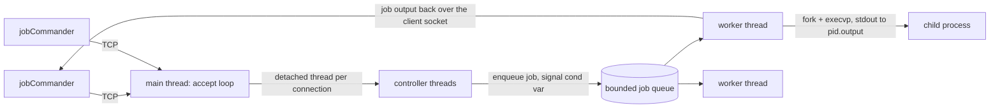

# Job Executor Server

A **job scheduling server in C** that accepts shell commands ("jobs") from clients, queues them, and runs them as child processes with a configurable concurrency limit. It comes in two implementations that show the same system built on two IPC models:

| Version | Transport | Concurrency model |
|---|---|---|
| [`v1-fifo-signals`](v1-fifo-signals) | Named pipes (FIFOs), single machine | Single-threaded server, `fork`/`exec` per job, `SIGCHLD` handler for scheduling |
| [`v2-tcp-threads`](v2-tcp-threads) | **TCP sockets**, works over the network | **Thread pool** of workers plus a controller thread per client, synchronized with mutexes and condition variables |

> Built for the *System Programming* course (Dept. of Informatics & Telecommunications, University of Athens, 2024).

## Commands

| Command | Description |
|---|---|
| `issueJob <cmd> [args...]` | Queue a job. It runs as soon as a slot is free. |
| `setConcurrency <N>` | Change how many jobs may run at the same time |
| `stop <job_ID>` | Remove a queued job (v1 can also stop a running one) |
| `poll` (v2) / `poll running\|queued` (v1) | List queued or running jobs |
| `exit` | Terminate the server |

---

## v2: Multithreaded TCP server



- The **main thread** `accept()`s connections and starts a detached **controller thread** for each client.
- Controller threads parse the command. For `issueJob` they push onto a **bounded queue** of size `bufferSize` and wake workers with `pthread_cond_broadcast`.
- A fixed **pool of worker threads** waits on a condition variable until there is work *and* the number of active jobs is below the current concurrency. A worker then `fork()`s and `execvp()`s the job with `stdout` redirected to `<pid>.output`, waits for it, and **streams the output back to the client that submitted the job**.
- Shared state (queue, active-worker counter, concurrency level) is protected by a `pthread_mutex`. Shutdown uses a `sig_atomic_t` flag and a broadcast so every thread exits cleanly.

```bash
cd v2-tcp-threads
make                                     # builds bin/jobExecutorServer, bin/jobCommander, bin/progDelay

./bin/jobExecutorServer 7856 8 3         # <port> <bufferSize> <threadPoolSize>

# from another terminal (or another machine)
./bin/jobCommander localhost 7856 issueJob ls -l include
./bin/jobCommander localhost 7856 setConcurrency 2
./bin/jobCommander localhost 7856 poll
./bin/jobCommander localhost 7856 exit
```

```text
JOB <job_1, ls -l include> SUBMITTED
----- job_1 output start------
total 8
-rwxr-xr-x 1 user user 861 DequeInterface.h
-rwxr-xr-x 1 user user 163 variables.h
----- job_1 output end------
```

## v1: FIFOs and signals

- The first call to `jobCommander` **forks the server process** and stores its PID in `jobExecutorServer.txt`. Later calls detect the running server and reuse it.
- Commander and server exchange messages over **two named pipes** (one per direction).
- The server keeps a *queued* deque and a *running* deque. When a job finishes, the **`SIGCHLD` handler** reaps it with `waitpid(..., WNOHANG)` and promotes the next queued jobs up to the concurrency limit.
- Includes Bash helper scripts: `multijob.sh` submits every line of one or more files as a job, and `allJobsStop.sh` stops all queued and running jobs, using `awk` to parse `poll` output.

```bash
cd v1-fifo-signals
make jobCommander progDelay
./jobCommander issueJob ./progDelay 5
./jobCommander poll running
./jobCommander exit
```

## Concepts demonstrated

POSIX threads (thread pool, detached threads) · mutexes and condition variables (producer/consumer) · TCP socket programming (`socket`, `bind`, `listen`, `accept`, `connect`) · process creation and `execvp` · signals and async-safe reaping · named pipes · I/O redirection · Bash scripting

## Author

**Giorgos Fragkakis** · [GitHub](https://github.com/fragk17)
